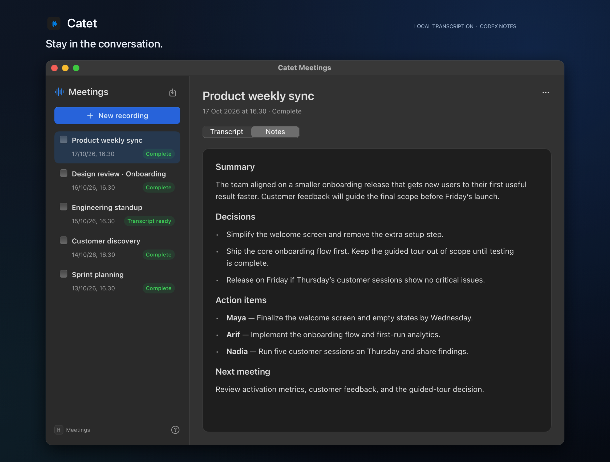

# Catet

A native macOS meeting recorder with live local transcription and meeting notes through Codex.



*Actual app UI with demo meeting data.*

## Setup

Requires Apple Silicon, macOS 14+, Apple’s command-line tools, Nix, Codex CLI signed in with ChatGPT (`codex login`), and a valid code-signing identity in your login Keychain.

```sh
./setup.sh
./catet open
```

Setup installs `/Applications/Catet.app`. Setup and the first recording need internet to download models. Later recordings use the cached models offline.

## Use

- Record from the floating control or menu bar. Get participants’ consent and allow microphone access. Online meetings also need screen/system audio permission. Catet saves audio only.
- Read the live transcript in the meeting library. Stop to finish the transcript and create notes if enabled.
- Open **Catet → Settings…** for recording preferences. Press **Control+Option+Space** for quick recording and **?** in the library for shortcuts.

Recordings stay in `~/Library/Application Support/Catet/meetings` for review and retries. Use the app to manage them while recording or processing is active. Run `./catet --help` for imports and CLI usage.

## Privacy

Audio and transcription stay on your Mac. Creating meeting notes sends the transcript to Codex through your ChatGPT account. Configured integration commands can share files with other systems. Review transcripts and notes before sharing.

## Integrations

Connect Catet to an internal system with a local executable that receives one JSON event on stdin. Your executable can read the saved files and call your system's API.

Create `~/Library/Application Support/Catet/hooks.json`:

```json
{
  "command": ["/Users/you/bin/catet-hook"],
  "events": ["notes.ready", "processing.failed"]
}
```

Use an absolute executable path and grant execute permission (`chmod +x`). Arguments go in the same array. Commands run directly, without shell expansion. With `--root`, put `hooks.json` beside the meetings root instead.

Available events are `recording.saved` (kept recordings and imports), `transcript.ready`, `notes.ready`, and `processing.failed`. Omit `events` to receive all four. Example payload:

```json
{
  "schema_version": 1,
  "id": "7d98a0c8-d455-431b-98d3-a480cebf9fd5",
  "event": "notes.ready",
  "occurred_at": "2026-10-17T17:47:27.738Z",
  "meeting": {
    "id": "meeting-id",
    "title": "Weekly planning",
    "status": "complete",
    "directory": "/path/to/meetings/meeting-id"
  },
  "files": {
    "metadata": "/path/to/meetings/meeting-id/meeting.json",
    "transcript_text": "/path/to/meetings/meeting-id/transcript.txt",
    "notes": "/path/to/meetings/meeting-id/mom.md"
  }
}
```

Payloads contain metadata and existing local file paths, not transcript contents. Processing failures also include a sanitized `failure` object. Keep integration credentials in your executable's own secure configuration.

Exit `0` within 30 seconds to acknowledge an event. Hook failure leaves the meeting's status unchanged. Inspect delivery state and diagnostics, then retry failed events:

```sh
./catet hooks list
./catet hooks retry
```

Queued events and diagnostics stay under `~/Library/Application Support/Catet/runtime/hooks`. Pending and interrupted deliveries resume when Catet starts or processing runs. Deduplicate by event `id` because interrupted delivery can repeat. Queued events retain their original command and arguments, so fix that executable before retrying.

Hooks cover new events after configuration. They do not backfill existing meetings. A sudden exit between saving meeting state and queueing its event can miss that event. Remove `hooks.json` to pause queueing and delivery.

## Development

Run `./install.sh` to rebuild and replace the installed app. Finish active recordings and processing first. Run `./test.sh` for regression checks.

MIT. See [LICENSE](LICENSE).
